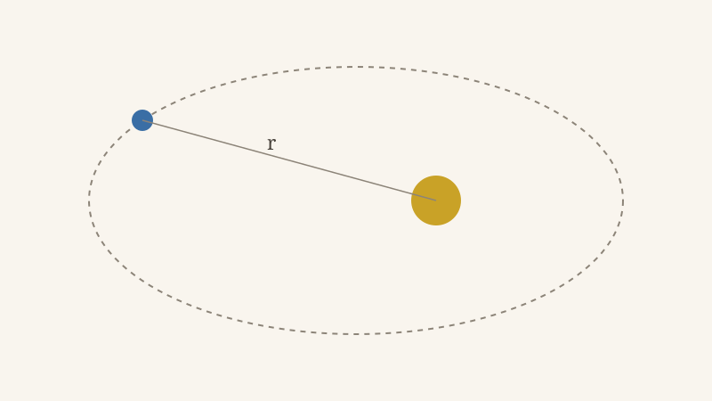
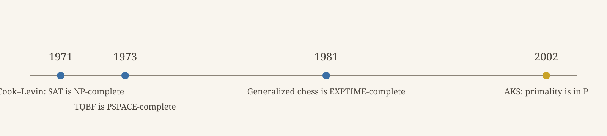

Lorem ipsum dolor sit amet, sed do eiusmod tempor incididunt ut labore et dolore magna aliqua, in the years 1991, 2025, and 2026.

Ut enim ad minim veniam, quis nostrud exercitation ullamco laboris nisi ut aliquip ex ea commodo consequat.

> [!status]
> This page is used to test the design features of this site.

## Typography

Incomprehensibilities, electroencephalographically, and counterrevolutionaries. 0123456789, 3.14159, and 1,729. Set in [Source Serif 4](https://github.com/adobe-fonts/source-serif).

Sed ut perspiciatis unde omnis iste natus error sit voluptatem accusantium doloremque laudantium.

This paragraph tests the uneven ink, which should look faintly blotchy only under close inspection. Nemo enim ipsam voluptatem quia voluptas sit aspernatur aut odit aut fugit, sed quia consequuntur magni dolores eos qui ratione voluptatem sequi nesciunt.

*Italic*, **bold**, ***bold italic***, ~~strikethrough~~, `inline code`, and `https://example.com/a/very/long/path/that/keeps/going/and/going/without/any/spaces`.

### Lists

- An unordered item.
- An item with a nested list:
  - A nested item.
  - Another nested item with a longer line of text that wraps onto a second line on narrow screens.
- A final item.

1. An ordered item.
2. A second item.
   - A nested item.
   - Another nested item with a longer line of text that wraps onto a second line on narrow screens.
3. A third item.

### Tables

| Class | Example problem | Known inclusion | Year |
|---|---|---|---:|
| P | Primality testing | P ⊆ NP | 2002 |
| NP | Boolean satisfiability | NP ⊆ PSPACE | 1971 |
| PSPACE | True quantified Boolean formulas | PSPACE ⊆ EXPTIME | 1973 |
| EXPTIME | Generalized chess | EXPTIME ⊆ EXPSPACE | 1981 |

### Figures


*An orbit, drawn to no scale. The line marks the distance $r$ from the star.*

> [!wide]
> 
> *Four results from the table above, on a timeline.*

## Sidenotes

Lorem ipsum dolor sit amet.[^short]

Quis autem vel eum iure reprehenderit.[^long] Vel illum qui dolorem eum fugiat.[^close] At vero eos et accusamus.[^math]

At vero eos et accusamus et iusto odio dignissimos.[^short]

### Citations

Lorem ipsum dolor sit amet.[^turing] Consectetur adipiscing elit.[^turing] Sed do eiusmod tempor.[^rice] Ut labore et dolore.[^cites]

[^short]: A short sidenote.

[^long]: A long sidenote. Temporibus autem quibusdam et aut officiis debitis aut rerum necessitatibus saepe eveniet ut et voluptates repudiandae sint et molestiae non recusandae. Itaque earum rerum hic tenetur a sapiente delectus.

[^close]: A sidenote close behind the long one.

[^math]: A sidenote with math, $\mathsf{P} \subseteq \mathsf{NP}$, and a link to [the Wikipedia article on complexity classes](https://en.wikipedia.org/wiki/Complexity_class).

[^cites]: A sidenote with a citation.[^turing]

[^turing]: [Turing 1936](https://doi.org/10.1112/plms/s2-42.1.230), §8.

[^rice]: [Rice 1953](https://doi.org/10.1090/S0002-9947-1953-0053041-6)

## Links

### Internal links

A section of this note: [[#Typography|Lorem Ipsum > Typography]]. An alias: [[#Math|the math section]]. A note whose title has punctuation: [[dolor-sit-amet|Dolor Sit Amet :"><,.?/+-~`]]. An unpublished note, as plain text: [[Some Private Note]].

### External links

- A GitHub repository: [asemorales/bierstadt](https://github.com/asemorales/bierstadt).
- An arXiv paper: [Attention Is All You Need](https://arxiv.org/abs/1706.03762).
- A DOI: [MobileLookNet](https://doi.org/10.1145/3663976.3664235).
- A Wikipedia article: [Halting problem](https://en.wikipedia.org/wiki/Halting_problem).
- The same article again: [the halting problem](https://en.wikipedia.org/wiki/Halting_problem).
- A page with a hand-written annotation: [gwern.net design](https://gwern.net/design).
- A dead link: [a page that no longer exists](https://dead-link-test.invalid/page).

## Math

Let $f : \mathbb{N} \to \mathbb{N}$ be total and computable, and let $\varphi_e$ be the $e$-th partial computable function.

$$
\begin{equation}
K = \{ e \in \mathbb{N} : \varphi_e(e)\!\downarrow \}
\label{eq:halting}
\end{equation}
$$

Equation $\eqref{eq:halting}$ defines the diagonal halting set.

$$
\begin{prooftree}
\AxiomC{$\Gamma \vdash A$}
\AxiomC{$\Gamma \vdash A \to B$}
\RightLabel{$\to$E}
\BinaryInfC{$\Gamma \vdash B$}
\end{prooftree}
$$

$$
\begin{CD}
A @>f>> B \\
@VgVV @VVhV \\
C @>>k> D
\end{CD}
$$

## Code

This section tests every Shiki token color. The Python block shows imports, comments, keywords, functions, types, strings, escapes, and constants.

```python
from dataclasses import dataclass  # imports are teal

@dataclass
class Collatz:
    """Count steps until n reaches 1."""

    limit: int = 1_000

    def steps(self, n: int) -> int | None:
        count = 0
        while n != 1 and count < self.limit:
            n = n // 2 if n % 2 == 0 else 3 * n + 1
            count += 1
        print(f"{n=}\t{count}")
        return count if n == 1 else None
```

This diff tests inserted, deleted, and range colors.

```diff
@@ -1,3 +1,3 @@
 def collatz_steps(n: int) -> int:
-    steps = 0
+    count = 0
```

This Markdown block tests headings, markup, links, inline code, and quotes.

```md
# Heading

**Bold**, *italic*, ~~struck~~, and `inline code`.

- [A link](https://example.com)

> A quote.
```

```sh
npm run sync && git push
```

## Quotes

### Default quote

> Lorem ipsum dolor sit amet, consectetur adipiscing elit, sed do eiusmod tempor incididunt ut labore et dolore magna aliqua.

### Epigraph

> [!quote] Jorge Luis Borges, *[The Library of Babel](https://en.wikipedia.org/wiki/The_Library_of_Babel)*
> There was no personal problem, no world problem, whose eloquent solution did not exist somewhere in some hexagon.

### Separator

***

Ut enim ad minim veniam, quis nostrud exercitation ullamco laboris nisi ut aliquip ex ea commodo consequat.

## Infobox

> [!infobox] NP
> - **Full name:** Nondeterministic polynomial time
> - **Defined by:** Polynomial-time verifiers
> - **See also:** [NP-completeness](https://en.wikipedia.org/wiki/NP-completeness)
> - **Complete problems:** SAT, 3-coloring, Hamiltonian path
> - **Contains:** P
> - **Contained in:** PSPACE

Lorem ipsum dolor sit amet, consectetur adipiscing elit, sed do eiusmod tempor incididunt ut labore et dolore magna aliqua.

## Headings

### A third-level heading

#### A fourth-level heading

## Reading

This page's length tests the scroll-depth events, which fire as the reader passes 25%, 50%, 75%, and 90% of the prose. Lorem ipsum dolor sit amet, consectetur adipiscing elit, sed do eiusmod tempor incididunt ut labore et dolore magna aliqua.
