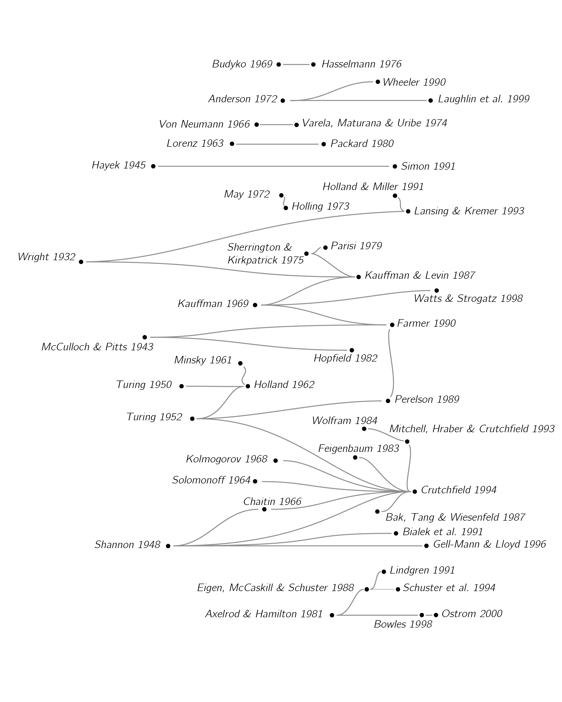

This page contains dummy text used to test the design features of this site.

> [!status]
> Ase is a human and may make mistakes.

## Typography

Incomprehensibilities, electroencephalographically, counterrevolutionaries, pneumonoultramicroscopicsilicovolcanoconiosis. 0123456789, 3.14159, and 1,729. Set in [Source Serif 4](https://github.com/adobe-fonts/source-serif). *Italic*, **bold**, ***bold italic***, ~~strikethrough~~, `inline code`, and `https://example.com/a/very/long/path/that/keeps/going/and/going/without/any/spaces`.

**This paragraph tests an opening sentence set entirely in bold.** That sentence renders in small caps, and the rest of the paragraph stays in roman.

**This paragraph tests bold that stops mid-sentence**, which stays bold because the opening sentence continues past it.

### Lists

- An unordered item.
- An item with a nested list:
  - A nested item.
  - Another nested item with a longer line of text that wraps onto a second line on narrow screens.
- A final item.

1. Here’s an itemized list of thirty years of disagreements
2. Sweet Jesus
   - Hey, I have not been shy
   - I am just a guy in the public eye
3. Trying to do my best for our republic

### Tables

| Class | Example problem | Known inclusion | Year |
|---|---|---|---:|
| P | Primality testing | P ⊆ NP | 2002 |
| NP | Boolean satisfiability | NP ⊆ PSPACE | 1971 |
| PSPACE | True quantified Boolean formulas | PSPACE ⊆ EXPTIME | 1973 |
| EXPTIME | Generalized chess | EXPTIME ⊆ EXPSPACE | 1981 |

### Figures

> [!figure]
> 
> Krakauer, D. C. (Ed.). (2024). *Foundational Papers in Complexity Science* (Vols. 1–4). SFI Press.

> [!wide-figure]
> 
> Raphael. (1509–1511). The school of Athens [Fresco]. Wikimedia Commons.

## Sidenotes

Lorem ipsum dolor sit amet.[^short]

Quis autem vel eum iure reprehenderit.[^long] At vero eos et accusamus.[^math]

At vero eos et accusamus et iusto odio dignissimos.[^short]

This paragraph tests quotes in sidenotes, with the quote's lines indented and unindented. Nam libero tempore.[^quote] Cum soluta nobis est eligendi optio.[^flat-quote]

This paragraph tests a status notice in a sidenote. Temporibus autem quibusdam.[^status-note]

This paragraph tests a definition in a sidenote, with examples and an etymology. Nam libero tempore.[^definition-note]

This paragraph tests a footnote that is only a link, which stays a sidenote without the `cite-` prefix. Et harum quidem rerum facilis.[^link-only]

### Citations

A citation.[^cite-turing] Same citation again.[^cite-turing] Another citation.[^cite-rice] A sidenote with a citation.[^cites] A citation without a link.[^cite-hofstadter]

[^short]: A short sidenote.

[^long]: A long sidenote. Temporibus autem quibusdam et aut officiis debitis aut rerum necessitatibus saepe eveniet ut et voluptates repudiandae sint et molestiae non recusandae. Itaque earum rerum hic tenetur a sapiente delectus.

[^math]: A sidenote with math, $\mathsf{P} \subseteq \mathsf{NP}$, and a link to [the Wikipedia article on complexity classes](https://en.wikipedia.org/wiki/Complexity_class).

[^quote]: > [!quote] Jorge Luis Borges, *[The Library of Babel](https://en.wikipedia.org/wiki/The_Library_of_Babel)*
    > An indented quote in a sidenote.
    > Its second line stays on its own line.

[^flat-quote]: > [!quote] Jorge Luis Borges, *[The Library of Babel](https://en.wikipedia.org/wiki/The_Library_of_Babel)*
> An unindented quote in a sidenote.

[^status-note]: > [!status]
    > A status notice in a sidenote.

[^definition-note]: > [!definition] lorem (noun)
> Dummy text.
>
> ### Examples
>
> - lorem ipsum dolor
> - sit amet
>
> ### Etymology
>
> > [!quote] Jorge Luis Borges, *The Library of Babel*
> > A quote in a definition in a sidenote.

[^link-only]: [gwern.net design](https://gwern.net/design)

[^cites]: A sidenote with a citation.[^cite-turing]

[^cite-turing]: [Turing 1936](https://doi.org/10.1112/plms/s2-42.1.230), §8.

[^cite-rice]: [Rice 1953](https://doi.org/10.1090/S0002-9947-1953-0053041-6), *Lorem ipsum*, p. 358.

[^cite-hofstadter]: Hofstadter, 1979, *Gödel, Escher, Bach*.

## Links

### Internal links

A section of this note: [[#Typography|Lorem Ipsum > Typography]]. An alias: [[#Math|the math section]]. A note whose title has punctuation and whose popover shows an epigraph: [[dolor-sit-amet|Dolor Sit Amet :"><,.?/+-~`]]. An unpublished note, as plain text: [[Some Private Note]].

This paragraph tests popovers on glossary terms. Lorem ipsum [[glossary#entelechy (noun)|entelechy]]. An alias: [[glossary#entelechy (noun)|entelechia]].

### External links

- A GitHub repository: [asemorales/bierstadt](https://github.com/asemorales/bierstadt).
- An arXiv paper: [Attention Is All You Need](https://arxiv.org/abs/1706.03762).
- A DOI: [MobileLookNet](https://doi.org/10.1145/3663976.3664235).
- A Wikipedia article: [Halting problem](https://en.wikipedia.org/wiki/Halting_problem).
- The same article again: [the halting problem](https://en.wikipedia.org/wiki/Halting_problem).
- A page with a hand-written annotation: [gwern.net design](https://gwern.net/design).
- A page with no annotation, which previews its first paragraph: [Tufte CSS](https://edwardtufte.github.io/tufte-css/).
- A dead link: [a page that no longer exists](https://dead-link-test.invalid/page).

## Math

Let $f : \mathbb{N} \to \mathbb{N}$ be total and computable, and let $\varphi_e$ be the $e$-th partial computable function.

$$
\begin{equation}
K = \{ e \in \mathbb{N} : \varphi_e(e)\!\downarrow \}
\label{eq:halting}
\end{equation}
$$

Equation $\eqref{eq:halting}$ defines the diagonal halting set.

$$
\begin{prooftree}
\AxiomC{$\Gamma \vdash A$}
\AxiomC{$\Gamma \vdash A \to B$}
\RightLabel{$\to$E}
\BinaryInfC{$\Gamma \vdash B$}
\end{prooftree}
$$

$$
\begin{CD}
A @>f>> B \\
@VgVV @VVhV \\
C @>>k> D
\end{CD}
$$

## Code

```python
from dataclasses import dataclass

@dataclass
class Collatz:
    """Count steps until n reaches 1."""

    limit: int = 1_000

    def steps(self, n: int) -> int | None:
        count = 0
        while n != 1 and count < self.limit:
            n = n // 2 if n % 2 == 0 else 3 * n + 1
            count += 1
        print(f"{n=}\t{count}")
        return count if n == 1 else None
```

```diff
@@ -1,3 +1,3 @@
 def collatz_steps(n: int) -> int:
-    steps = 0
+    count = 0
```

```md
# Heading

**Bold**, *italic*, ~~struck~~, and `inline code`.

- [A link](https://example.com)

> A quote.
```

```sh
npm run sync && git push
```

## Quotes

### Default quote

> Lorem ipsum dolor sit amet, consectetur adipiscing elit, sed do eiusmod tempor incididunt ut labore et dolore magna aliqua.

### Quote with line breaks

> This quote tests that each source line keeps its own line.
> Lorem ipsum dolor sit amet,
> consectetur adipiscing elit.

### Epigraph

> [!quote] Jorge Luis Borges, *[The Library of Babel](https://en.wikipedia.org/wiki/The_Library_of_Babel)*
> There was no personal problem, no world problem, whose eloquent solution did not exist somewhere in some hexagon.

***

## Definitions

This paragraph tests a definition with a term, examples, an etymology, and attributed quotes, in the column.

> [!definition] lorem (noun)
> Dummy text set in place of real copy.
>
> > [!quote] Cicero, *De Finibus*
> > A quote in the body of a definition.
>
> ### Examples
>
> - lorem ipsum dolor
> - sit amet
>
> ### Etymology
>
> A clipped form of *dolorem*.
>
> > [!quote] Seneca, *Letters*
> > A quote in a section of a definition.

This paragraph tests a definition with neither a term nor optional sections.

> [!definition]
> Dummy text set in place of real copy.

## Headings

### A third-level heading

#### A fourth-level heading

## Reading

This page's length tests the scroll-depth events, which fire as the reader passes 25%, 50%, 75%, and 90% of the prose.

This paragraph tests the wildlife in the footer garden. The number of visitors grows with the number of notes tended in the past 30 days. Scroll to the bottom to see the fireflies flash in sync. Hover over or tap the garden to scatter fireflies, hide the snail, shake a web, blow a dandelion, or puff a mushroom's spores.
